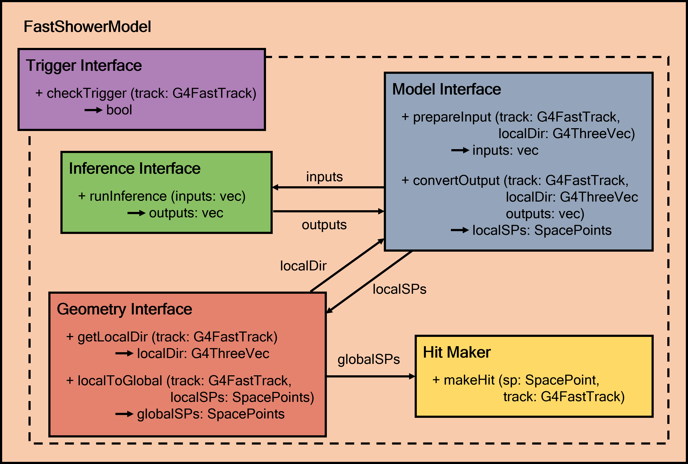
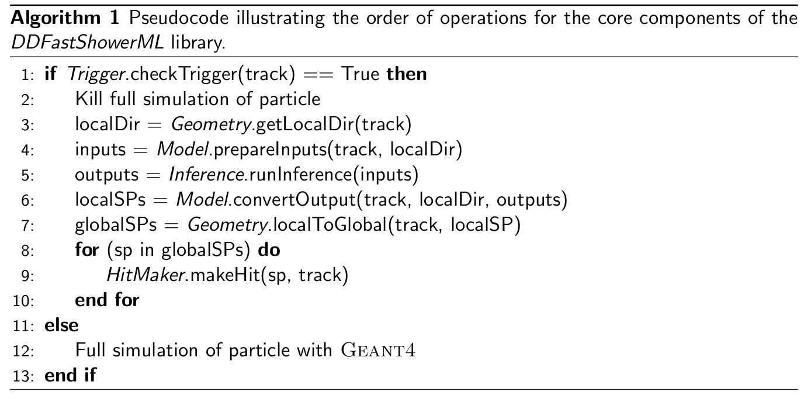

# DDML
[](https://doi.org/10.5281/zenodo.17475368)
[](https://github.com/key4hep/DDML/actions/workflows/key4hep.yml)
[](https://github.com/key4hep/DDML/actions/workflows/pre-commit.yml)
[](https://www.apache.org/licenses/LICENSE-2.0)

Library with utilities and plugins that allow running fast simulation in a Geant4 application using ML inference from within ddsim (DDG4).

### References
1. *Fast Simulation of Highly Granular Calorimeters with
Generative Models: Towards a First Physics Application*, P. McKeown et al., PoS EPS-HEP202 3 (2024) 568, DOI: [10.22323/1.449.0568](https://pos.sissa.it/449/568)

2. *Development and Performance of a Fast Simulation Tool for Showers in High Granularity Calorimeters based on Deep Generative Models*, P.McKeown, DESY-THESIS 186 pp. (2024), DOI: [10.3204/PUBDB-2024-01825](https://bib-pubdb1.desy.de/record/607309)


## Quick start guide

### Environment Setup
Access to `cvmfs` required.

The library can be run in apptainer with an Ubuntu 22.04 docker image as follows, with bind mounting to `cvmfs`:
```
mkdir cvmfs
export APPTAINER_CACHEDIR=<path_to_your_cachedir>
export APPTAINER_TMPDIR=<path_to_your_tmpdir>
apptainer shell --bind /cvmfs:/cvmfs docker://ghcr.io/key4hep/key4hep-images/ubuntu22:latest
```

### Installation

Prerequisites:
- a key4hep release. This will provide:
	- DD4hep, Geant4, podio, EDM4hep, LCIO, ...
- ONNXRuntime
- libTorch.so/dylib
- Python 3 (development files) and pybind11 for the embedded Python
  inference backend (can be disabled with
  `-DDDML_ENABLE_EMBEDDED_PYINFERENCE=OFF`). NumPy is needed at runtime.

This setup can be achieved with the setup script provided:

```
source setup_env_nightly.sh
```

However, if you do setup with that script, you must rebuild whenever the nightly changes. You might alternatively wish to chose a fixed tag, and build to that. For example;

```
source /cvmfs/sw.hsf.org/key4hep/setup.sh -r 2026-04-08
# then the rest of the setup script;

TORCH_PATH=$(dirname $(python -c 'import torch; print(f"{torch.__file__}")'))
export CMAKE_PREFIX_PATH=${CMAKE_PREFIX_PATH}:${TORCH_PATH}/share/cmake
export LD_LIBRARY_PATH=${LD_LIBRARY_PATH}:${TORCH_PATH}/lib

ONNXRUNTIME_PATH=$(dirname $(python -c 'import onnxruntime; print(f"{onnxruntime.__file__}")'))
export LD_LIBRARY_PATH=${LD_LIBRARY_PATH}:$(realpath ${ONNXRUNTIME_PATH}/../../../../)/lib64  # CentOS7
export LD_LIBRARY_PATH=${LD_LIBRARY_PATH}:$(realpath ${ONNXRUNTIME_PATH}/../../../../)/lib    # Ubuntu
```

You need to do that setup again, whenever you return with a fresh shell.

Now build as usual (one time process)

```
mkdir build
cd build
cmake ..
make -j4 install
```

and ensure to set up the library correctly

```
source ../install/bin/thisDDML.sh
```
which also will require repeating in every fresh shell.

### Running the example

The simulation can then be run as usual with ddsim- for example for the ILD detector:

```
cd ../scripts
ddsim --steeringFile ddsim_steer.py --compactFile $k4geo_DIR/ILD/compact/ILD_l5_o1_v02/ILD_l5_o1_v02.xml
```

Depending on the setup in `ddsim_steer.py`, either a `.slcio` file or a `.edm4hep.root` file can be written

Events can be visualised in the standard way for `.slcio` file or a `.edm4hep.root` files, e.g for `.slcio` with ILD:

```
ced2go -d $k4geo_DIR/ILD/compact/ILD_l5_o1_v02/ILD_l5_o1_v02.xml dummyOutput.slcio
```

## Structure of the Library

The library has the following key components:

- **Trigger**: Kill the full simulation and run the fast simulation, if conditions are fulfilled
- **Model**: Prepare the model input, and interpret the output
- **Geometry**: Place spacepoints produced by the model (localToGlobal). Also provide local direction of track at calorimeter face
- **Inference**: Calls desired inference library for the model. The library currently supports LibTorch, OnnxRuntime and calling a Python function via an embedded interpreter (see [Embedded Python inference](doc/embedded_python_inference.md))
- **Hit Maker**: Geant4 helper class for placement of energy deposits that land in a sensitive detector region

The structure of the library is summarised in the following class diagram:



And the order of operations is as follows:




## More technical details

For running the example with a given DD4hep detector, there has to be a region
defined in which the fast ML shower simulation will be run.

Depending on the detector of interest, this would involve making a local copy of lcgeo/k4geo (available under `$k4geo_DIR`), and modifying the xml description of the detector element:


```diff
diff --git a/ILD/compact/ILD_common_v02/SEcal06_hybrid_Barrel.xml b/ILD/compact/ILD_common_v02/SEcal06_hybrid_Barrel.xml
index 5ff2e50..084f7ea 100644
--- a/ILD/compact/ILD_common_v02/SEcal06_hybrid_Barrel.xml
+++ b/ILD/compact/ILD_common_v02/SEcal06_hybrid_Barrel.xml
@@ -1,7 +1,14 @@
 <lccdd>
+
+  <regions>
+    <region name="EcalBarrelRegion">
+    </region>
+  </regions>
+
   <detectors>

-    <detector name="EcalBarrel" type="SEcal06_Barrel" id="ILDDetID_ECAL" readout="EcalBarrelCollection" vis="BlueVis" >
+    <detector name="EcalBarrel" type="SEcal06_Barrel" id="ILDDetID_ECAL" readout="EcalBarrelCollection" vis="BlueVis"
+     region="EcalBarrelRegion">

       <comment>EM Calorimeter Barrel</comment>

```

### Python configuration

DDML provides a `ddml` python module for easily adapting a ddsim simulation. The
example `ddsim_steer.py` file is also configured using this. The steering file
imports two helpers and wires them into ddsim in three lines:

```python
from ddml import ddml_physics, get_presets_from_args

presets, record_calo_entry = get_fastsim_configuration()
SIM.physics.setupUserPhysics(ddml_physics(presets, record_calo_entry))
```

The `ddml` python package (and the wrappers in `python/examples`) are
installed alongside the library and are made available by sourcing
`thisDDML.sh`. The model files are installed to `share/DDML/models` and are
looked up from there (see `ddml.paths.model_path`), so the steering files can
be run from any directory. To use a different model directory set
`DDML_MODEL_DIR`.

If you work directly with the python files from the source tree instead (i.e.
`export PYTHONPATH=${PATH_TO_THIS_DDML}/python:${PATH_TO_THIS_DDML}/python/examples:$PYTHONPATH`),
you also need to point `DDML_MODEL_DIR` to a directory containing the models,
e.g. `<build>/models`, where the build places symlinks to the downloaded models.

One or more named model configurations (defined in `python/ddml/configs.py`) are then
selected on the command line with the `--ml-model` flag:

```
ddsim --steeringFile ddsim_steer.py \
      --compactFile $k4geo_DIR/ILD/compact/ILD_l5_o1_v02/ILD_l5_o1_v02.xml \
      --ml-model CC3_BARREL --ml-model CC3_ENDCAP
```

Repeat `--ml-model` to compose multiple presets (e.g. barrel + endcap).

To add a custom model configuration, instantiate a `ModelConfig` (from
`ddml.model`) with the desired `plugin`, `geometry`, `plugin_properties`, and
trigger settings, and pass it directly to `ddml_physics`:

```python
from ddml import ddml_physics, ModelConfig
from ddml.configs import ILD_BARREL, EM_PARTICLES, EM_TRIGGER_10_GEV

my_model = ModelConfig(
    plugin="MyPlugin/MyModel",
    geometry=ILD_BARREL,
    plugin_properties={"ModelPath": "../models/my_model.pt"},
    applicable_particles=EM_PARTICLES,
    triggers=EM_TRIGGER_10_GEV,
    correct_angles=False,
)
SIM.physics.setupUserPhysics(ddml_physics([my_model]))
```


In addition to the models imported with python, it is also possible to run a model directly on a python kernel.
One example of this is baked into this repository; see `scripts/ddsim_steer_photon_gun_cc3py.py`, which is a steering file for running the [CaloClouds3](https://arxiv.org/pdf/2511.01460) model via a python kernel, with inbuilt photon.
Running it requires supplying the detector model only. After the standard setup;

```
ddsim --steeringFile ddsim_steer_photon_gun_allshowerspy.py  --compactFile $k4geo_DIR/ILD/compact/ILD_l5_v02/ILD_l5_v02.xml
```

The basic framework to run the [AllShowers](https://arxiv.org/pdf/2601.11716) is already in place in the repository, but as the model is not itself compiled (yet), the user must install the code for it separately. It's also a little sensitive to the torch version. Full details can be seen in [`ALLSHOWERS_notes.md`](./ALLSHOWERS_notes.md).


## Coding style

Coding style is partially enforced. Formatting is done via `clang-format` using
the configuration found in `.clang-format`. Additionally there are minimal
`clang-tidy` checks that enforce that class names are *CamelCase* and that
private and protected member variables have an `m_` prefix and are in
*camelBack* case.
